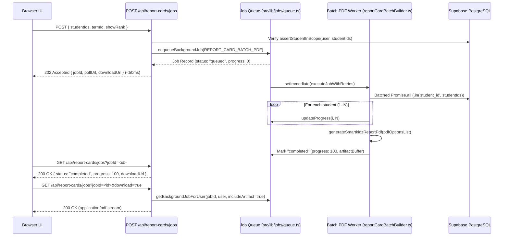

# BACKGROUND PROCESSING ARCHITECTURE
**System:** Leaders International School ERP  
**Workstream:** Workstream C (Priority: HIGH)  
**Date:** November 2026  

---

## 1. Architectural Overview

Long-running operations—such as generating combined multi-student report card PDFs for an entire class (30–60 students), bulk invoice generation, and batch notification dispatch—must not block HTTP worker threads or risk gateway timeouts.

Phase 2 introduces a non-blocking, idempotent background job architecture consisting of:
1. **Queue & Worker Engine (`src/lib/jobs/queue.ts`)**:
   - Manages job lifecycle states: `queued` -> `processing` -> `completed` | `failed`.
   - Tracks granular item progress (`processedItems`, `totalItems`, `progress` `0..100%`).
   - Enforces **idempotency keys** (`<userId>:<jobType>:<idempotencyKey>`) so double-clicking "Generate Class Report Cards" returns the existing in-flight or completed job instead of spawning duplicate PDF renders.
   - Implements **exponential backoff retries** (`retryBaseDelayMs * 2^(attempt - 1)`, default `maxAttempts = 3`) for transient failures, transitioning cleanly to `failed` with a structured `errorMessage` if all attempts are exhausted.
   - Enforces **strict user ownership and Cambridge/NECTA wing isolation** via `getBackgroundJobForUser()`.
2. **Database Persistence Table (`public.background_jobs`)**:
   - Defined in `supabase/migrations/20261115183000_phase2_performance_indexes_and_views.sql` with RLS enabled (`created_by = auth.uid()`).
3. **Batch Report Card Job Endpoint (`src/app/api/report-cards/jobs/route.ts`)**:
   - `POST /api/report-cards/jobs`: Validates student scope (`assertStudentInScope`), enqueues a `REPORT_CARD_BATCH_PDF` job, and returns `202 Accepted` in `<50ms` with `jobId`, `pollUrl`, and `downloadUrl`.
   - `GET /api/report-cards/jobs?jobId=<uuid>`: Returns live progress (`0..100%`) and status (`queued`, `processing`, `completed`, `failed`).
   - `GET /api/report-cards/jobs?jobId=<uuid>&download=true`: Verifies caller ownership and wing permissions, then streams the completed `application/pdf` buffer with `Cache-Control: private, no-store, max-age=0`.
4. **Batched Report Card Builder (`src/lib/reportCardBatchBuilder.ts`)**:
   - Replaces the legacy N+1 per-student query loop (~300 sequential queries for 30 students) with a batched `Promise.all` prefetch (~9 queries total), updating job progress after each student's report card page is compiled.

---

## 2. Job Lifecycle Sequence Diagram

---

## 3. Security & Multi-Wing Isolation Controls

- **Pre-Enqueue Scope Verification:** Every `student_id` in a batch request is validated via `assertStudentInScope(user, sId)` before the job is created.
- **Artifact Ownership Isolation:** `getBackgroundJobForUser()` verifies that `job.createdBy === user.id` (or the caller holds `System Admin`, `Director`, or `Principal` role) AND that `job.wing` matches the caller's assigned wing (`Cambridge` vs `NECTA`).
- **Bounded Memory Footprint:** Completed job artifacts expire automatically after 30 minutes (`JOB_RETENTION_MS`) and the in-memory store is capped at `MAX_IN_MEMORY_JOBS = 250` with FIFO/TTL eviction.
